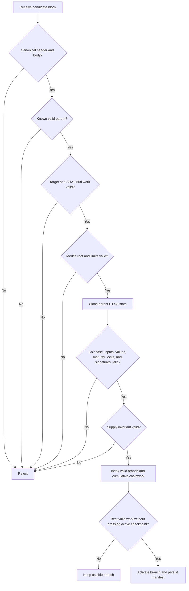
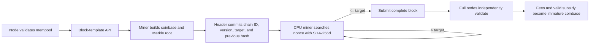
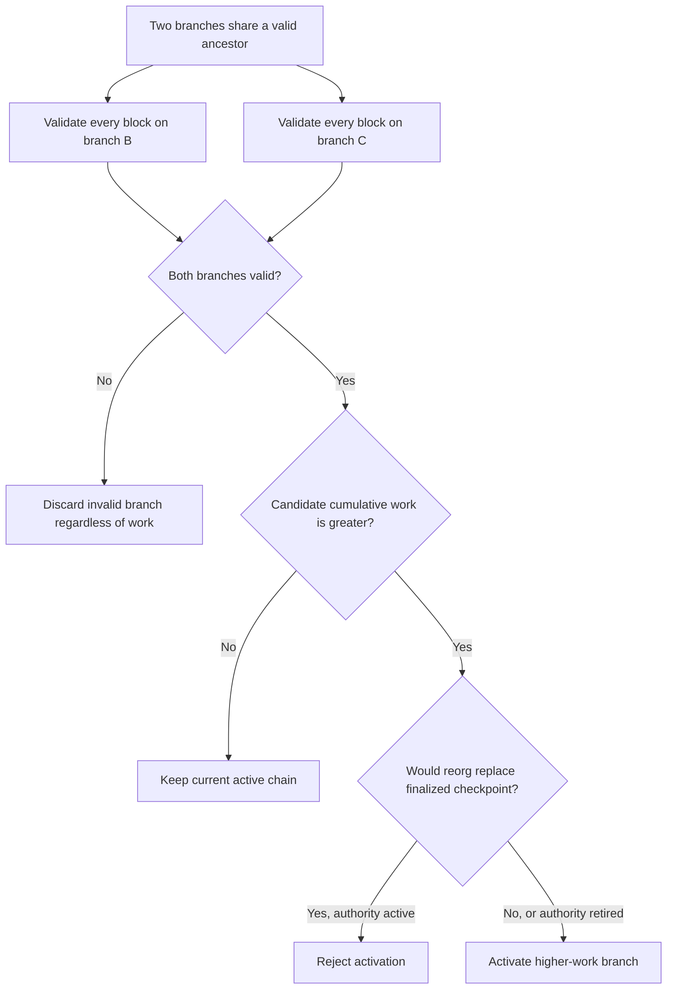
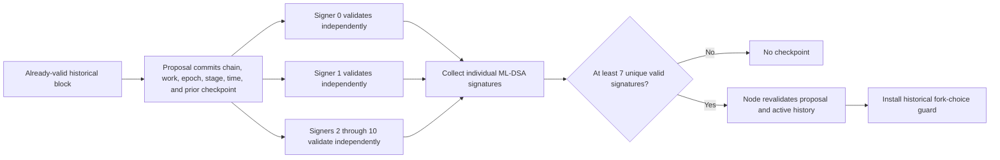
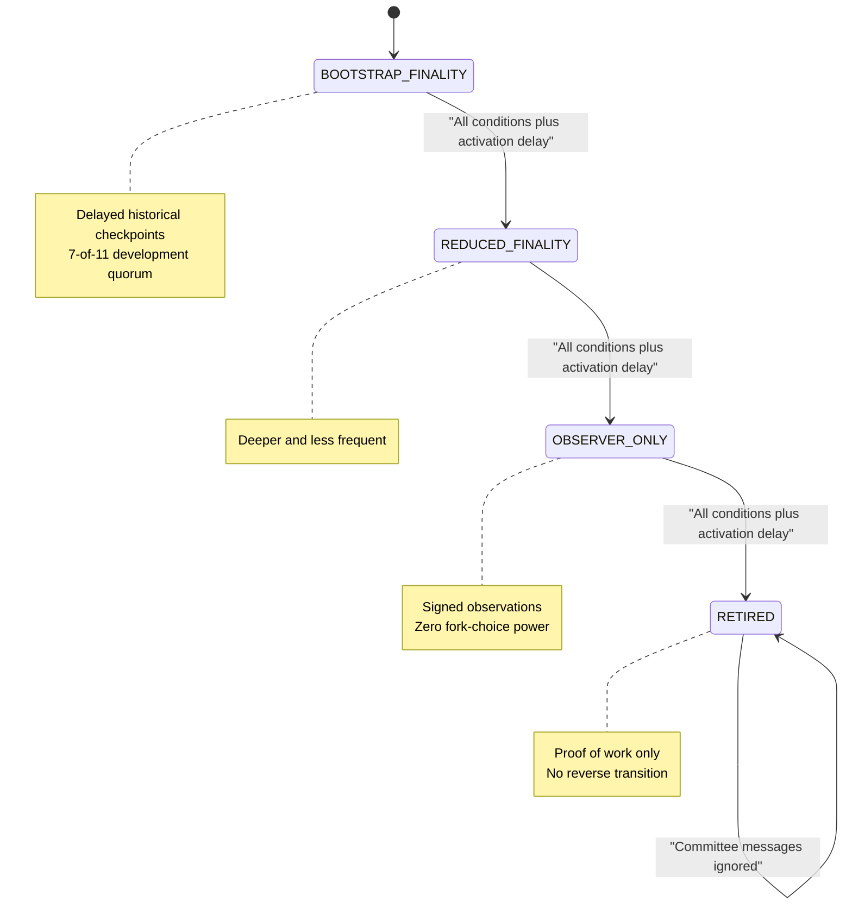
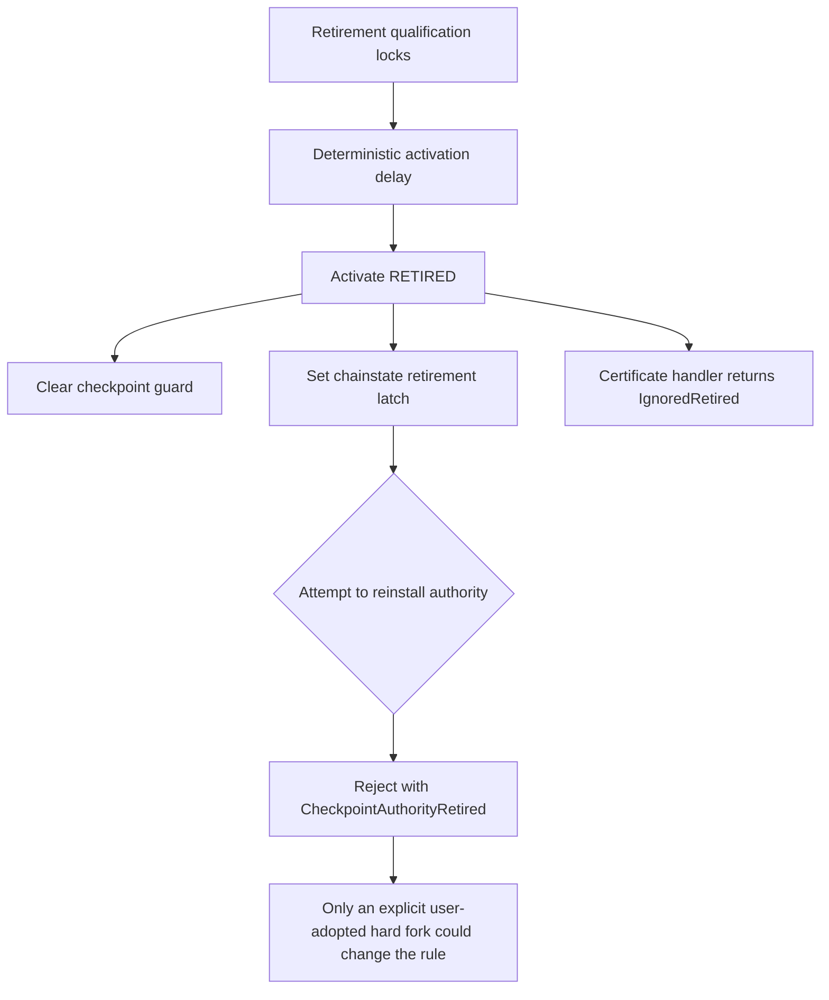
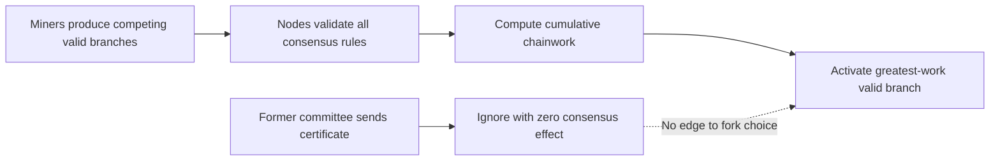
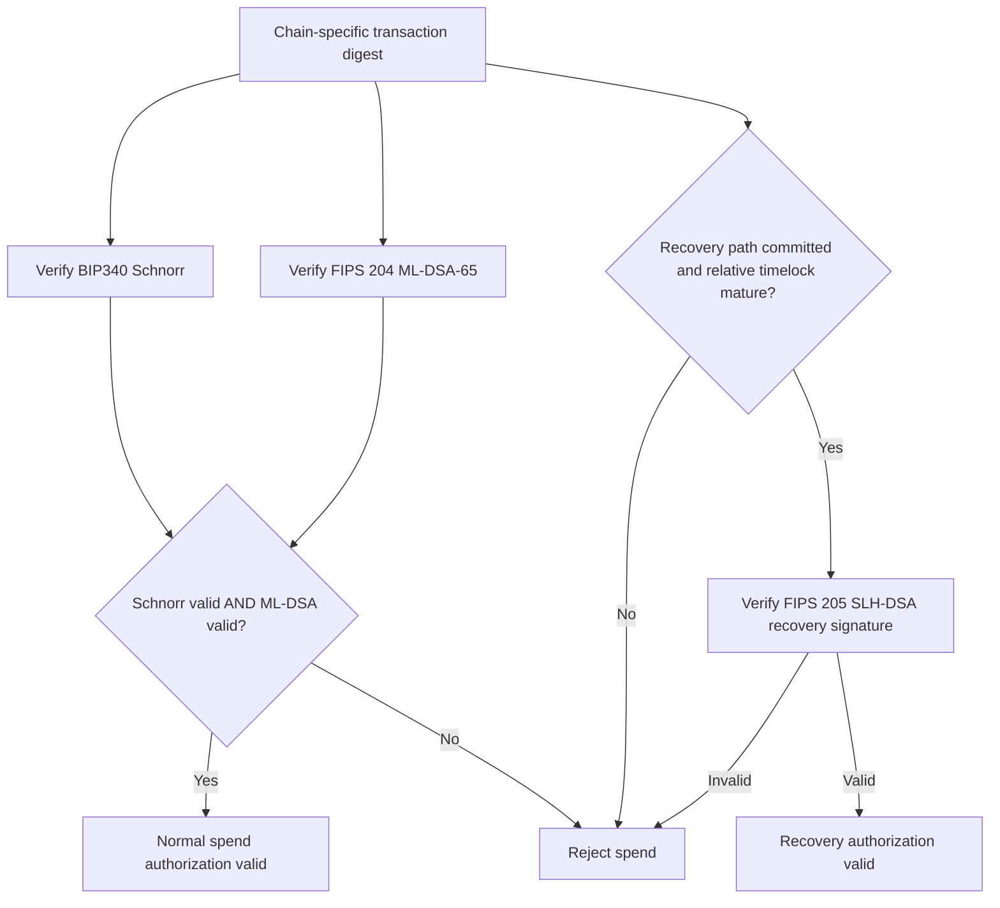

# Architecture Diagrams

These diagrams describe intended protocol boundaries. Dashed or labeled
research edges may not yet be wired into the running multi-process node.

## Transaction Flow

```mermaid
flowchart LR
    U["Wallet owner selects UTXOs"] --> C["Construct deterministic transaction"]
    C --> S["Create Schnorr and ML-DSA signatures"]
    S --> L["Local policy and encoding check"]
    L --> R["Submit to full node REST or P2P"]
    R --> V["Node validates UTXO, amounts, weight, and both signatures"]
    V --> M["Admit to mempool"]
    M --> B["Miner includes transaction in candidate block"]
    B --> N["Every node validates again"]
```

## Full-Node Validation

## Mining

## Competing-Chain Selection

## Checkpoint Quorum

## Progressive Authority Reduction

## Irreversible Sunset

## Post-Sunset Proof-of-Work Operation

## Hybrid Signature Authorization

